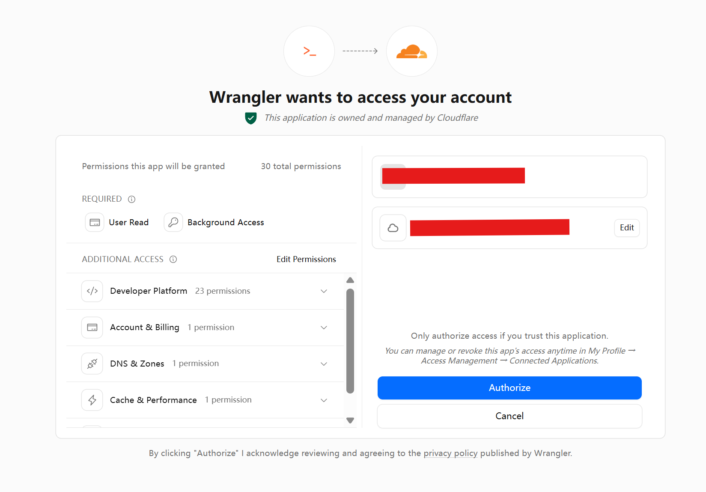
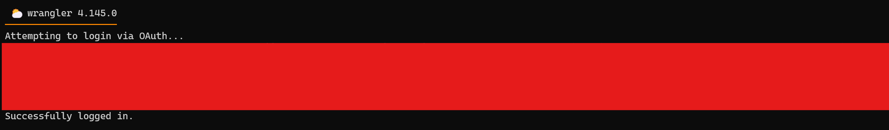
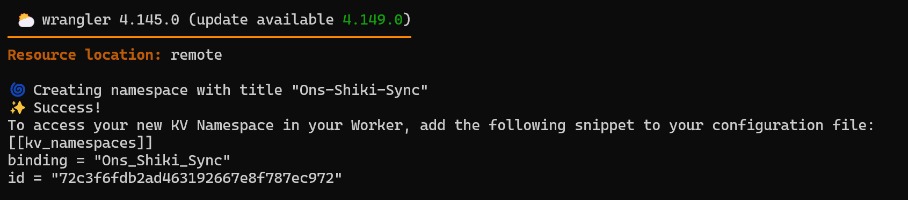
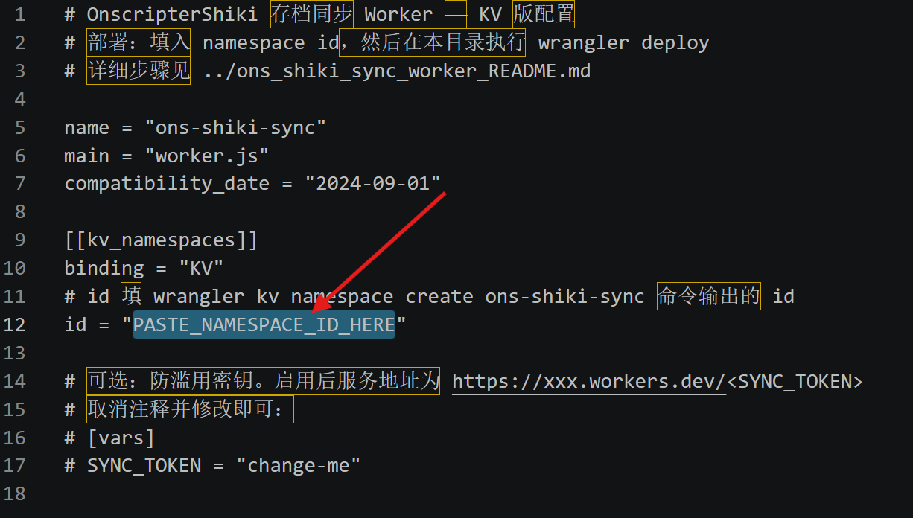

# 一、项目简介

[OnscripterShiki](https://github.com/GJMJimmy/OnscripterShiki)是基于[OnscripterYuri](https://github.com/YuriSizuku/OnscripterYuri)二次开发的一个增强型 ONScripter 项目，主要修复web端bug、优化web端体验。

::github{repo="GJMJimmy/OnscripterShiki"}

web部署教程可以参考[OnscripterYuri](https://github.com/YuriSizuku/OnscripterYuri)的`README`或这篇博客<a href="/posts/ons-web/">如何在网站上游玩ONS版Galgame？</a>

## 在原有基础上的修改

**Bug修复**

- 修复虚拟按键`menu`、`skip`不起作用的问题
- 修复 `em_import` 不返回 Promise 导致"恢复存档后一刷新就丢档"的问题

**新增功能**

- **云存档**：把 Emscripten 的存档目录打包成 zip 上传/下载，可以部署到服务器或worker

- **界面美化**：增加可拖动悬浮球，单击打开/关闭菜单；菜单改为深色毛玻璃风格，可以自定义颜色和透明度 

- **离线缓存**：可以选择一次性缓存全部资源，离线后也可游玩

# 二、部署云存档服务

服务器和Worker二者选其一即可

## 1、服务器
下载release中的python脚本：[点击下载](https://github.com/GJMJimmy/OnscripterShiki/releases/latest/download/ons_shiki_sync_server.py)\
\
运行：
```bash
python3 ons_shiki_sync_server.py
```
默认端口为`8765`\
如果想指定端口可以加上`--port`：
```bash
python3 ons_shiki_sync_server.py --port [数字]
```
### 后台运行
同步服务需要挂在后台持续运行，推荐用nohup或systemd\
**nohup**
```bash
nohup python3 -u ons_shiki_sync_server.py > sync.log 2>&1 &
```
**systemd**\
创建文件/etc/systemd/system/sync.service：
```bash
[Unit]
Description=OnscripterShiki save-sync server
After=network.target
StartLimitIntervalSec=0

[Service]
WorkingDirectory=/py脚本所在目录
ExecStart=python3 /py脚本所在目录/ons_shiki_sync_server.py
Restart=always
RestartSec=3

[Install]
WantedBy=multi-user.target
```
运行：
```bash
systemctl daemon-reload
sudo systemctl enable --now sync
```

## 2、Worker
Worker有KV版和R2版，区别如下：

| 目录 | 存储 | 强一致 | 单份上限 | 免费额度 | 是否需绑卡 |
|---|---|---|---|---|---|
| **`R2版`** | R2 对象存储 | 是（传完即可取） | 64MB | 10GB 存储 + 每月百万级操作 | 需要绑卡（免费额度内不扣费） |
| **`KV版`** | Workers KV | 否（传播最长 60 秒） | 24MB | 每天 1000 次写 | 不需要 |

我以KV版为例\
下载release中的KV版Worker文件：[点击下载](https://github.com/GJMJimmy/OnscripterShiki/releases/latest/download/ons-shiki-sync-worker-kv.zip)\
解压后进入文件夹根目录并执行：
```bash
npx wrangler login
```
wrangler会调起浏览器打开Cloudflare授权页面，点击`Authorize`授予 wrangler 访问权限

如果授权成功，终端会显示登陆成功

先创建KV namespace
```bash
wrangler kv namespace create ons-shiki-sync
```
如图所示，创建成功后会输出id，复制输出的id

打开`wrangler.toml`并粘贴到此处

保存后在文件夹根目录执行：
```bash
wrangler deploy
```
等待部署完成即可

# 三、云存档使用方法
打开`菜单`->`上传/恢复存档`

填入服务器或Worker的链接即可
